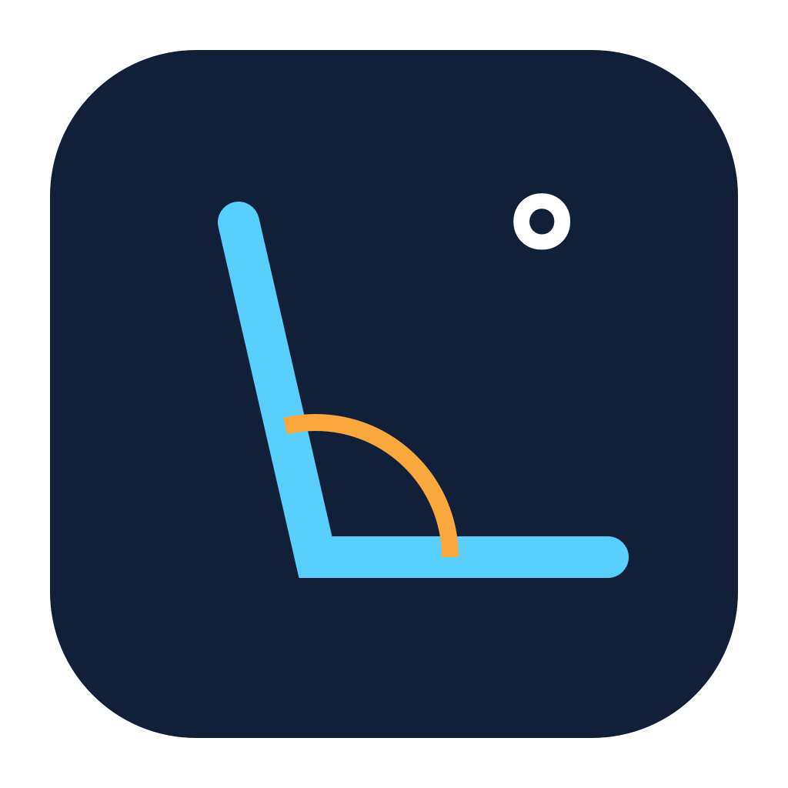
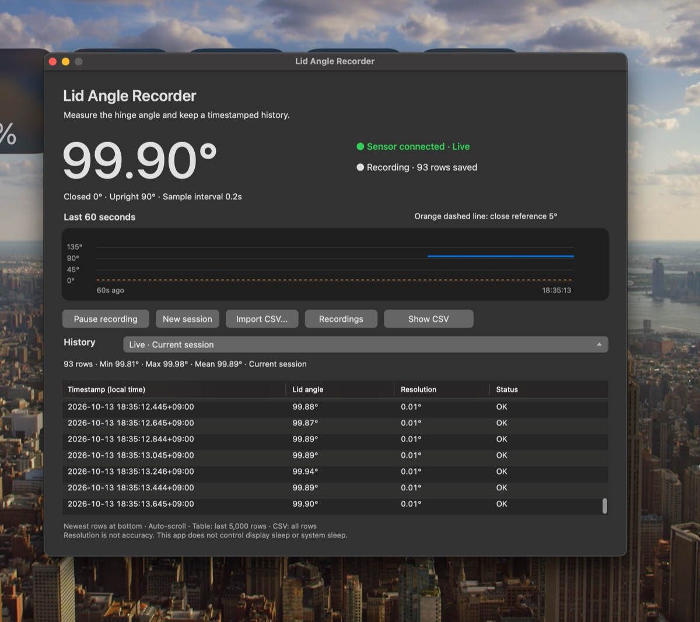

<p align="center">
  
</p>

# Lid Angle Recorder

A native macOS app for measuring the MacBook display hinge angle and keeping a timestamped CSV history. Built with Objective-C, AppKit, and IOKit; no third-party runtime dependencies.

<p align="center">
  
</p>

## License

This project is **source-available** under the project-specific [Lid Angle Recorder Use and Modification License](LICENSE).

- You may use, study, and modify it for your own use, including internal work use.
- You may not sell the original or modified software, offer paid access, or include it in a paid product without the copyright holder's prior written permission.
- Redistribution of source or binaries, including free redistribution of modified versions, also requires prior written permission.
- Keep the license and copyright notices. Third-party materials retain their own terms.
- Public-repository viewing and forking permissions independently granted by GitHub's terms are unaffected.

This is a custom license, not MIT, GPL, or an OSI-approved open-source license. See the complete LICENSE file for the governing terms.

## Features

- Live angle display, sampled approximately every 0.2 seconds.
- A chart showing the selected session's last 60 seconds.
- An orange dashed **5° close reference** line.
- Automatic CSV recording, pause/resume, and separate recording sessions.
- Session history, CSV import, and minimum/maximum/mean statistics.
- Chronological rows with automatic scrolling to the newest measurement at the bottom.
- English interface, local timestamps with UTC offsets, and Intel/Apple Silicon builds.

The **5° line is a visual reference**, not a guaranteed macOS display-off threshold. The app does not change display sleep, system sleep, or lid-close behavior. Reported resolution is not a statement of measurement accuracy.

## Requirements

- macOS 12 or later.
- A MacBook that exposes a compatible lid-angle HID sensor.
- Xcode Command Line Tools to build from source.

An Intel MacBook with a compatible sensor has been tested with live reads, CSV recording, pause/resume, session creation, and history loading. The universal binary supports both processor architectures; sensor availability and access have not been verified on every MacBook model. The interface is undocumented and may change between macOS versions.

## Build and run

```sh
xcode-select --install
chmod +x build.sh
./build.sh
open "dist/Lid Angle Recorder.app"
```

The build script compiles a universal binary, assembles the app bundle, and applies an ad-hoc signature. It does not create an Apple Developer ID signature or notarize the app. Downloaded builds may be subject to macOS Gatekeeper checks.

You can move the built app to Applications. To add a Desktop shortcut, drag it from Finder while holding Option and Command to create an alias.

## Usage

Recording starts automatically when the app opens.

| Control | Action |
| --- | --- |
| Pause recording / Resume recording | Stop or resume CSV writes while the live angle continues updating. |
| New session | Keep the previous CSV and begin a new file. |
| Import CSV... | Copy a compatible recording into the history folder. |
| Recordings | Open the recordings folder in Finder. |
| Show CSV | Reveal the selected session's CSV in Finder. |
| History | Switch between the current session and earlier recordings. |

The large angle at the top always shows the current sensor reading. The graph, table, and statistics show the session selected in History. The table displays up to the latest 5,000 rows, oldest to newest; the CSV retains the complete session. Statistics are calculated from valid measurements in the displayed rows.

Closing the window or pressing Command-Q stops recording and quits. Minimizing keeps recording. Sampling pauses while the Mac sleeps; the app reconnects to the sensor after wake. Sensor failures are saved as error rows with an empty angle.

## Recording location and format

Recordings are stored outside the app and repository:

```text
~/Library/Application Support/Lid Angle Recorder/Recordings/
```

CSV files use UTF-8 and this header:

```csv
timestamp,angle_degrees,resolution_degrees,status
```

The timestamp includes milliseconds and its UTC offset. A valid measurement has status `ok`; an unsuccessful read has an `error_0x...` status. Imported files must use the same four-column format.

The app has no networking or telemetry. Personal recordings and generated builds are excluded by `.gitignore`. The source ZIP contains no personal measurement history.

## Sensor interface

The app matches Apple's vendor ID `0x05AC`, sensor usage page `0x20`, and orientation usage `0x8A`. It reads HID feature report 7 as a little-endian 32-bit value in hundredths of a degree, falling back to report 1 as a little-endian 16-bit value in whole degrees. It does not write HID reports or seize exclusive access to the device.

Related community projects documenting this interface include [Sam Henri Gold's LidAngleSensor](https://github.com/samhenrigold/LidAngleSensor) and [ufoym/mac-angle](https://github.com/ufoym/mac-angle).

## Optional diagnostics

Run these on a MacBook with a supported sensor:

```sh
"dist/Lid Angle Recorder.app/Contents/MacOS/LidAngleRecorder" --once

"dist/Lid Angle Recorder.app/Contents/MacOS/LidAngleRecorder" \
  --self-check --records-directory /tmp/lid-angle-check
```

The self-check verifies live sensor reads, CSV round trips, pause/resume, new sessions, and loading the previous session. It opens the app briefly and exits when complete. Use `--records-directory` to keep diagnostic files separate from personal history.

## Repository contents

```text
src/main.m              App and sensor implementation
assets/Info.plist       App bundle metadata
assets/AppIcon.icns     App icon
tools/IconGenerator.m   Original vector drawing source for the icon
build.sh                Universal macOS app build
LICENSE                 Use/modification terms; no sale or redistribution
.gitignore              Excludes recordings and generated files
```

Upload this source directory to GitHub. The separately packaged app ZIP is intended for a release attachment; it is not needed to build the source.
